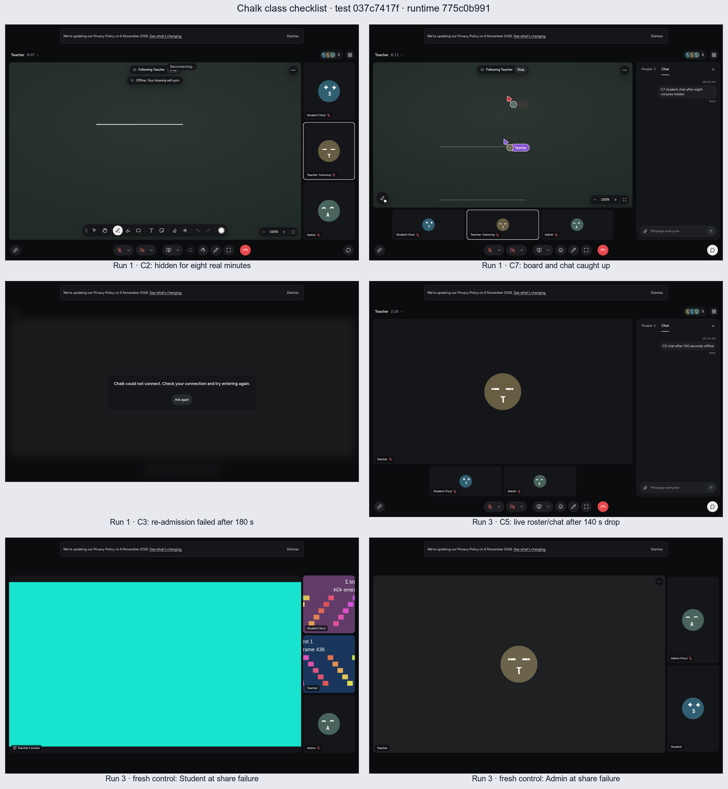

# Class checklist browser proof

**Result: no-go on the requested baseline. All three full suite invocations exited 1.**

Runtime baseline: `775c0b99140879634e1753a6f0164af10086a8fd`. Frozen test implementation: `037c7417ff27952dc0d03f988907e83f4c3a7096`.
No product runtime fixes are included. The opt-in slow suite starts a real local
API, PostgreSQL-backed Sync and web app with the approved development SFU.
Teacher, Student and Admin use separate native Chromium processes/contexts.
Capture inputs are generated; admission, transport, decoding and UI are real.
See [the runner instructions](../../../scripts/web-proof/class-checklist.md).

## In-class response: 28 October 2026 failures

These are operator checks, not additional browser-proof passes. Record the
Episode ID and time in **PKT**. Use the agreed fallback call if recovery fails;
do not keep the class waiting through repeated retries.

### W33: audio/video cannot reconnect while chat or the board still works

1. Spot frozen or missing media and a persistent reconnecting notice; working chat does not prove media is healthy.
2. For missing audio, ask the affected person to mute, then unmute. Confirm another person can hear them.
3. If media is still broken, rejoin once. Use **Report a problem** before leaving when available.
4. If rejoining does not restore media, move to the agreed fallback and report the Episode ID and PKT time.

### W34: joining fails after a slow camera/microphone start

1. Spot a long camera/microphone startup followed by a failed join or **Try again**. Do not assume it is a permission denial.
2. Check the browser's camera/microphone permission and selected devices, then rejoin once.
3. Use **Report a problem** when available; include the Episode ID and PKT time. Automatic reports do not prove delivery to support.
4. If the join still fails, move to the agreed fallback.

### W35: microphone looks on locally but classmates see muted and hear nothing

1. Compare both views: ask a classmate whether the person appears muted and whether they can hear them. A local mic-on icon is not proof of sound.
2. Ask the affected person to mute, then unmute. Check the classmate's badge and received audio again.
3. If still silent, use **Report a problem** when available, then rejoin once. Record the Episode ID, PKT time and device/browser.
4. If classmates still cannot hear them, move to the agreed fallback. Do not ask others to override their mute controls.

## Coverage before this change

No complete C1–C7 case had full real-stack coverage at the baseline.

| Case / bug   | Existing evidence at baseline                                                                                                                                                                                                                                       | Full case already covered?            | New exact browser checks                                                                                                                                                             |
| ------------ | ------------------------------------------------------------------------------------------------------------------------------------------------------------------------------------------------------------------------------------------------------------------- | ------------------------------------- | ------------------------------------------------------------------------------------------------------------------------------------------------------------------------------------ |
| C1 / W29     | `tests/call.e2e.ts:8`: real initial admission and media with two browsers.                                                                                                                                                                                          | No; real-stack partial only.          | All three initial admissions timed; Student enters five times total through four Leave/Rejoin cycles. Each join <10 s; exactly one tile per role on every side.                      |
| C2 / W26     | #564: `sdks/typescript/client/scripts/background-heartbeat.mjs` + `apps/sync/test/support/browser/background_heartbeat.exs`: headful Chromium and real Sync/Postgres, including 21m15s hidden; socket-close/ended-reconnect wire tests. No full API/media host app. | No; browser/Sync proof only.          | Separate native processes; muted/camera-off Student actually hidden for eight real minutes; continuous roster-loss checks on all three sides.                                        |
| C3 / W28     | #568: `sdks/typescript/client/src/space-client/startup-failures.test.ts:637,674`, replaced browser/network boundaries around expired admission.                                                                                                                     | No.                                   | Close Student tab, keep an unjoined blank tab so native Chrome survives, wait 180 s, navigate a fresh tab in the same context. Saved automatic entrance and all three rosters <10 s. |
| C4 / W27     | #565: `scripts/web-proof/connection-lost.mjs`, real Chromium/SDK/UI against an in-process Sync protocol fixture.                                                                                                                                                    | No; not real multi-user API/Sync/SFU. | Actual 60 s DevTools-offline interval, exact terminal heading and one Rejoin button, zero stale tiles, one click and live roster <10 s.                                              |
| C5 / W27/W28 | #565/#568 terminal/retry fixtures, not a visible 140 s real-stack outage.                                                                                                                                                                                           | No.                                   | 140 s real wait; Student-only IPv4/IPv6 external and local-stack traffic cut, including SFU/UDP. One Rejoin, no reload, exact roster and chat.                                       |
| C6 / W27     | `tests/call.e2e.ts:8`: real audio/video on initial admission, not recovery/restarted display capture.                                                                                                                                                               | No; real-stack partial only.          | After C5: received audio both ways, advancing decoded camera/share frames, share to both peers, stop/restart <10 s, no duplicate tiles. Same helper runs in a fresh-call control.    |
| C7 / W26     | `tests/board.e2e.ts:176,206,357`: real board sync/layout/follow, no eight-minute hidden interval. #564 dual-socket proof is not a rendered-board check.                                                                                                             | No; real-stack partial only.          | Teacher draws while Student is hidden; exact element count and painted pixels catch up <10 s, then new stroke and chat <5 s, without reload/rejoin.                                  |

## Three frozen-revision repetitions

All six framework tests were attempted in each repetition, without retries.
BLOCKED means the real classroom fixture failed admission before the manual
case started; it is not a pass. Blocked setup times are framework durations.
Other times are case wall times; C1/C3 include fixture work. Each join/recovery
has its separate asserted deadline. C2/C7 share one hidden interval; C5/C6 share
one recovered call.

| Case                            | Run 1                   | Run 2                   | Run 3                   |
| ------------------------------- | ----------------------- | ----------------------- | ----------------------- |
| C1, five joins                  | PASS 18.880 s           | FAIL 14.686 s           | PASS 13.958 s           |
| C2, eight minutes hidden        | PASS 482.638 s          | BLOCKED (13.24 s setup) | PASS 481.578 s          |
| C3, three-minute absence        | FAIL 200.545 s          | BLOCKED (13.10 s setup) | BLOCKED (20.24 s setup) |
| C4, 60 s offline                | BLOCKED (15.49 s setup) | BLOCKED (13.23 s setup) | BLOCKED (17.83 s setup) |
| C5, 140 s drop                  | BLOCKED (12.73 s setup) | BLOCKED (12.73 s setup) | PASS 141.630 s          |
| C6, media after recovery        | BLOCKED with C5         | BLOCKED with C5         | FAIL 14.854 s           |
| C7, board/chat after background | PASS 2.389 s            | BLOCKED with C2         | PASS 2.390 s            |

| Run | Framework outcome  | Framework duration | Including stack startup/cleanup |
| --- | ------------------ | ------------------ | ------------------------------- |
| 1   | 2 passed, 4 failed | 762.80 s           | 835 s                           |
| 2   | 0 passed, 6 failed | 81.33 s            | 113 s                           |
| 3   | 2 passed, 4 failed | 750.11 s           | 766 s                           |

Fresh-call control: admission-blocked in Runs 1/2 (12.73/13.23 s); Run 3 failed
at the first share-video wait (38.02 s framework duration), after two-way audio
and camera assertions passed. The share restart was not reached.

## Retained failures

- **Admission:** Run 2 C1 timed out on the initial Teacher tile at
  `tests/class-checklist.e2e.ts:42`. Run 1 C3 timed out on Student after the real
  180 s absence at line 353. API logs record SFU `create_connection` transport
  failures (`http_status=0`, no upstream HTTP response), then local HTTP 500s on
  public creation/arrival routes. Other fixtures were blocked the same way.
  This does not establish a PC/ISP-specific W29 cause or isolate W28.
- **Recovered audio:** Run 3 C6 failed line 392: received audio stayed zero for
  the ten-second poll. Both generated sources were running with enabled live
  tracks and source level about 0.15. Teacher received Student audio (601
  packets, positive audio level); Student had no inbound audio report. Source
  silence does not explain it. Cause in the app, development SFU or network is
  not established. An earlier fresh-call control also failed one direction, so
  recovery-specific attribution is not established either.
- **Fresh share:** Run 3 control failed line 429 waiting ten seconds for a
  remote screen video. The failure capture shows a share on Student and none
  on Admin. The failed recipient index was not logged, so the image is not
  treated as proof of which wait failed. `screen-share:` IDs and the stage
  attribute were checked against the rendered component. C6 itself did not
  reach camera/share assertions after its audio failure.
- **C4 remains unresolved:** all final repetitions were admission-blocked.
  A separate diagnostic on test `7d5b6cdb18b8dcc5c224c09dc40fe854d7530230`
  executed the 60 s outage and failed because Rejoin stayed disabled after
  going online (75.098 s case time, click timed out at its line 148; retained
  at current line 174). No forced click, reload or runtime fix hides it.

Top: Run 1 hidden interval and board/chat catch-up. Middle: Run 1 C3 admission
failure and Run 3 successful 140-second roster/chat recovery. Bottom: Student
and Admin at Run 3's fresh-share failure. All frames use the frozen revision.
The hidden board can show reconnect/offline while rosters are retained; C7
checks its catch-up after foregrounding, not an always-connected hidden board.

## Limits

- Public app creator/guest role labels are not external-host role integration or account sign-in.
- Generated tones prove received/decoded audio, not intelligible speech or a physical speaker.
- Hidden Chromium and Linux firewall cuts do not prove a particular PC, Wi-Fi adapter or ISP. C8 is outside scope.
- Cases blocked at admission were not executed; post-audio C6 steps and share restart remain unproved in the final repetitions.
- Raw logs, private invitations, credentials and production identifiers are not published.
- No merge, production mutation or promote/nightly/npm workflow dispatch occurred.
