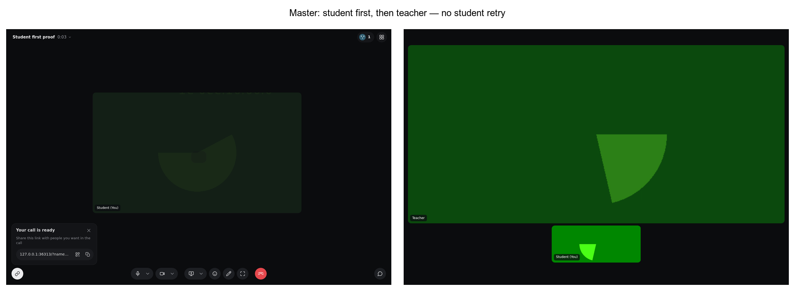

# Student-before-owner proof

On master `775c0b991`, a collaborator can enter an active Episode before any
owner exists. Joining an owner later updates the student's call automatically.
The browser makes no student clicks, reloads, or retries. Both video elements
are playing before the final screenshot.



## Scope

This is a diagnostic and regression proof for W30, not a product fix. It runs
the real local API, Postgres, Sync, SDK UI, and Cloudflare SFU in Chromium with
fake camera and microphone input. It does not run an integrating application's
access-preparation code, account sign-in, or recording pipeline.

The proof also checks Episode creation through the real server SDK:

- Replaying the same key and `startedAt` returns the same Episode.
- Reusing that key with a different `startedAt` returns
  `request.idempotency_conflict` (HTTP 409).

That conflict is a real caller error, not evidence that an owner is missing.
The proof keeps it as an error. No waiting state, retry policy, or admission
contract changes are included here.

## Run

Run on Instabox with the local stack ready, Chromium installed, and the server
SDK built. Load a local Tenant's key and ID into `CHALK_PROOF_API_KEY` and
`CHALK_PROOF_TENANT_ID` without printing their values. No hosted target is
accepted: API, Sync, and web hosts must be loopback addresses.

```sh
node scripts/web-proof/student-first.mjs
```

Defaults are API `http://127.0.0.1:8080`, Sync
`ws://127.0.0.1:4100/v1/sync`, and Vite `http://127.0.0.1:3070`.
Override them with `CHALK_PROOF_API_URL`, `CHALK_PROOF_SYNC_URL`, and
`CHALK_PROOF_WEB_URL`. The web server supplies the application's real stylesheet;
the proof bundles the same SDK source aliases as the web app.

Results and screenshots are written to `.private/web-proof/student-first`.
`CHALK_STUDENT_FIRST_DIRECTORY` overrides that directory. Browser contexts and
the loopback proof server close in the finalizer; the proof then ends its
Episode and archives its Space. Cleanup failures fail the proof.

[Recorded assertions](result.json) contain no credentials or customer data.
