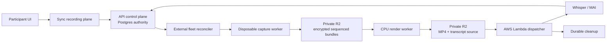

# Recording and transcription

A Recording moves from a durable start command through encrypted capture,
rendering, download, transcription and temporary-source cleanup. This document
keeps the decisions behind that pipeline and its release boundaries. Routes live
in the API contracts, and the code is under `apps/api/internal/recorderworker`,
`recordingpipeline`, `transcripts` and `apps/transcription-dispatcher`.

Related: [duration limits](recording/duration-limit.md), [completion recovery](recording/completion-recovery.md), [whiteboard assets](recording-whiteboard.md) and [managed releases](managed-release.md).

## Shape

Postgres is the sole authority for intent, admission, assignments, leases, fences,
attempts and terminal state. R2 is an object store, not a queue. Workers are
disposable executors with short-lived workload identity and object-scoped grants.
They never hold reusable cloud control, KMS or R2 credentials. The API verifies
every reported object independently before it commits completion.

## Decisions

| Decision                                                              | Reason                                                                                                                      |
| --------------------------------------------------------------------- | --------------------------------------------------------------------------------------------------------------------------- |
| Durable control facts precede external work                           | A retry, crash or provider timeout cannot invent or lose acknowledged Episode state.                                        |
| Jobs use generation, fence, lease and compare-and-set completion      | Late or replaced workers cannot overwrite newer truth.                                                                      |
| Provider inventory is reconciled outside OpenTofu                     | Pools scale and replace nodes quickly, while OpenTofu keeps owning immutable policy, caps, firewalls and image contracts.   |
| Workers get one-time bootstrap and job-scoped authority               | A compromised media worker cannot create infrastructure, list a bucket or decrypt another Recording.                        |
| Capture stores encrypted sequenced bundles, with explicit gap bundles | Work resumes after a handoff, and a pause, absent track or handoff stays on the timeline instead of silently shortening it. |
| Presentation facts and the UI build hash are frozen before render     | A retry renders the same layout and assets, not whatever the web release serves now.                                        |
| Render is CPU-based (`libx264`)                                       | It met the measured deadline, and a GPU dependency was unnecessary.                                                         |
| One pinned transcription provider per attempt                         | Failover cannot silently change privacy, residency, output shape or billing.                                                |
| Transcript finalization and source cleanup are durable jobs           | Provider success is not a complete customer artifact, and cleanup survives partial failure.                                 |

The render worker image and the API's allowed presentation UI hash must move
together. Treat them as one release tuple.

## Capture beside the SFU

An Episode on the Chalk SFU can have its capture run in a worker that stays on the SFU's node, so a Recording starts when that worker next polls, not when an on-demand machine boots. The worker is the same `recorder-capture` binary and the same claim, lease, fencing and bundle path as a fleet worker. What differs is placement and identity.

- **Placement is in the claim query.** A worker registered for an SFU node claims only the captures of Episodes bound to that node. Every other worker leaves a capture to the node's worker while it reports ready within the last 35 seconds, for `CHALK_SFU_COLOCATED_CAPTURE_GRACE_SECONDS` after the capture became available. After the grace, or at once when the worker is stale or closed, the fleet claims it as before. The database cannot see that a worker's slots are all busy, so a full worker looks the same as a slow one and costs the grace, never the Recording.
- **A failed attempt goes to the fleet.** Every attempt's owner is already recorded when the claim is made (`recording_job_attempt_authorities`). A capture whose earlier attempt ran on a colocated worker, and ended in a reported failure, a lapsed lease or a dead node, is no longer held for that worker and that worker can no longer claim it. The next attempt belongs to the fleet at once, so a worker that reports ready but cannot capture cannot use up the job's attempts alone.
- **Demand ignores held captures.** A capture the node's worker holds, or can take within the grace, adds no fleet demand, so the reconciler does not boot a machine for it. When the grace passes, or an attempt has failed there, the capture counts again and the fleet scales for it.
- **Identity matches the fleet's, in a registry of its own.** The worker presents a client certificate with one SPIFFE URI `environment/<env>/capture/<worker id>`, verified by the same `workeridentity.Verifier`. The ID is derived from the environment and node (`workeridentity.ColocatedWorkerID`), and the API registers it at start in `recording_colocated_capture_workers`, which the worker routes check next to `recording_fleet_nodes`. The rows are not in the fleet table because earlier releases read that table as the DigitalOcean fleet: a row there would stop an earlier reconciler and let an earlier claim query hand the worker any node's captures. The registration is revocable: revoking it stops the worker at its next request, and a restart of the API never reactivates it. The certificate comes from a capture CA of its own, apart from the SFU service CA, that the bridge trusts. It lasts 30 days and each deploy issues a new one, where a fleet worker's lasts 12 hours and renews itself.
- **The switch gates new claims only.** `CHALK_SFU_COLOCATED_CAPTURE` off stops the worker claiming and makes the fleet take every capture. A worker that holds a lease keeps its heartbeats, bundle commits and completion until the capture ends, as long as its registration is not revoked.
- **The fleet never lists it.** The reconciler reads only the fleet table, so it can neither scale nor delete a colocated worker.
- **The ledger shows the claim.** A claimed capture writes `recording.claimed` to the start journey, with `claim_lag_ms` (available to claimed), `placement` (`colocated` or `fleet`) and the attempt number.

The switch is `CHALK_SFU_COLOCATED_CAPTURE`. Off, the claim and demand queries behave exactly as before and the on-demand fleet takes every capture.

## Recording preparation

Preparation is a revisioned intent on a Space. A newer revision fences stale
reschedules and cancels, and retries of one command are idempotent. It creates no
Episode and captures nothing. Readiness is an observation of fresh, unoccupied
capacity, not a reservation. A real Recording consumes the intent atomically, and
cancelling never stops a running Recording.

## Transcript language

The tenant policy `transcript_language` is `auto` or a Whisper primary language
code such as `en`, `ur` or `ar`. A Space can override it, and `null` inherits.
At admission an explicit request `language` wins over the Space, then the tenant.
The resolved mode is stored on the transcript and every chunk job, so retries and
claims never re-read current settings.

Fixed mode sends the language to the qualified Whisper adapter. Auto uses
MAI-Transcribe-2 through OpenRouter when `CODESWITCH_PROVIDER=mai` is set. If MAI
is unavailable, Auto fails closed and retries. It never falls back to Whisper,
because that would change output quality and privacy without anyone choosing it.

## Submitted audio and cost

Cost follows audio actually submitted, not wall-clock time. The recorder cuts each
microphone source's full span into chunks of at most five minutes, with no voice
activity detection, and the decoder keeps silence in the source. So four
microphones over a one-hour meeting submit about four provider audio-hours before
retries. Muting does not remove duration. Only absent tracks or shorter spans do.

Silence is trimmed only in the MAI adapter, which removes long silence and keeps
an offset map to restore timestamps. Fixed-language Whisper still receives the
original audio. Trimming earlier, per speaking span before chunk encoding, is
feasible but must handle detection misses, quiet speech, all-silent sources and
the manifest's minimum of one chunk. Measure provider spend from reported
metadata, which is recorded only when the provider returns it. Do not quote a
price from this document.

## Boot check

`scripts/recorder/boot-check.py` is the release pipeline's isolated cold-boot
diagnostic for a candidate recorder image. It creates a separately tagged node
that cannot take live work, writes no pins, demand or fleet settings, and
collects guest evidence over short-lived presigned uploads, so no AWS credential
or identity key reaches the guest.

- PASS needs the candidate manifest, a matching issuer certificate, verified
  CA, identity and serial, and confirmed scoped cleanup. Registration alone is
  FAIL. A failed or interrupted attempt cannot be repaired into a passing receipt.
- A detached watchdog owns cleanup even if the caller exits. The default budget is
  eight minutes, below the release hook's ten-minute timeout. Never extend a
  release qualification past its caller timeout.
- On a cleanup failure, recover the exact owned IDs from the receipt's private
  evidence directory and `ledger.jsonl`. Never scan or delete shared production
  tags.

Only one release owner may publish recorder configuration, because SSM has no
atomic compare-and-swap. Publication rechecks the planned version immediately
before it writes and verifies the readback. On a failed deploy the Scheduler
stays disabled.

## Dispatcher binding during managed releases

The API authenticates each dispatcher request with an HMAC over the body, path,
release, environment, role, audience and tracing context. It checks the signature
window and consumes the nonce once. The release must equal the loaded API
component release (`CHALK_API_VERSION`), so an old or unapproved release stays
unauthorized.

`scripts/deploy/deploy-managed-release.mjs` moves the dispatcher binding forward
after the host controller proves a healthy deploy. For a changed API component it
needs a clean OpenTofu drift plan and a version-pinned source ZIP whose bytes
match the recorded SHA-256. It then allows only the Lambda release, configuration
digest, artifact location and matching tags to change, and requires a zero-drift
plan and a Lambda health, code digest and release readback afterwards.

The release fails if binding or verification fails, even when the host deploy
worked. Keep an existing scheduler pause until both pass, and never enable the
scheduler by hand before then. A failed Lambda apply can leave the log-group tag
ahead of the bound release: restore it to the bound release before retrying.
Requests running during a release can briefly get 401, and fenced retries
reconcile them. Dry runs report the selected ZIP digest and version but copy and
apply nothing. Production configuration is mandatory, and other environments use
their own scoped configuration, with no production fallback.
